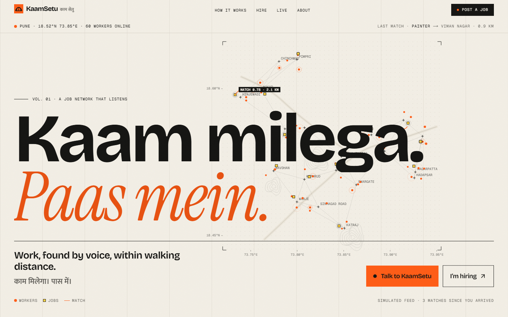
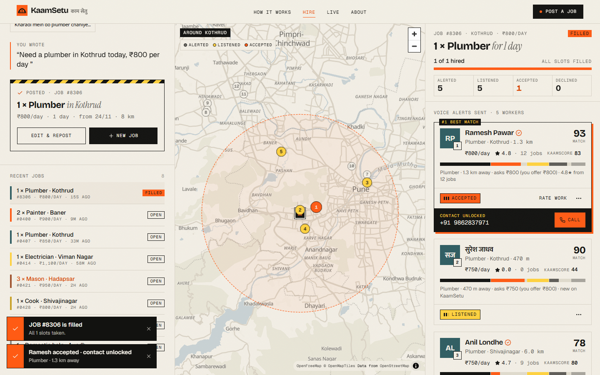
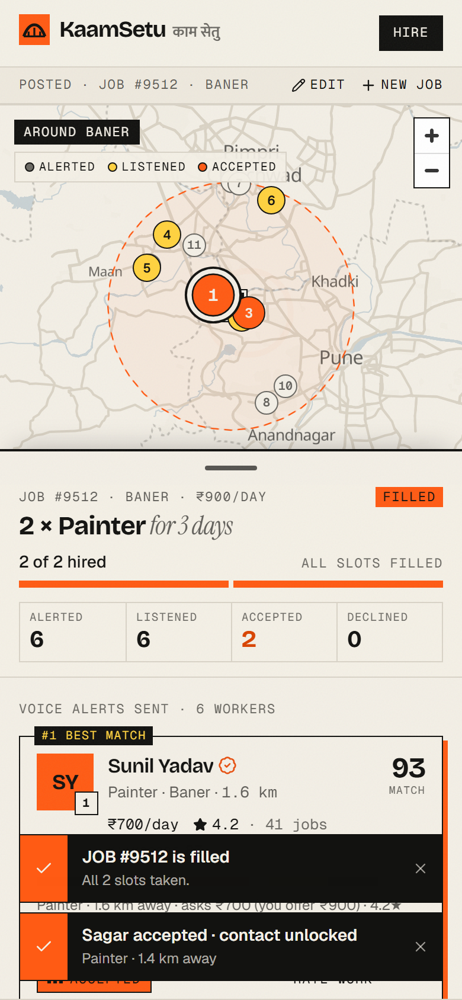
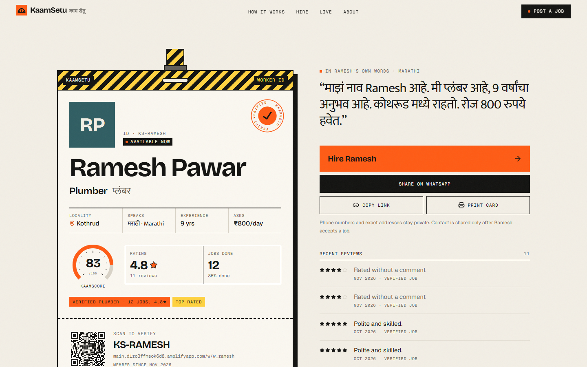
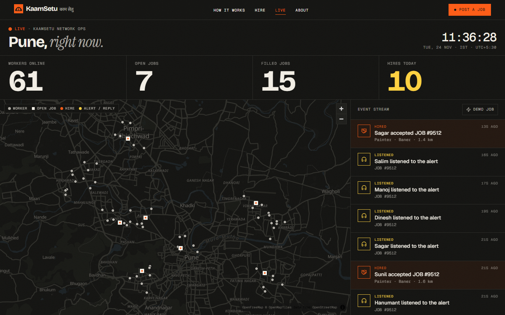
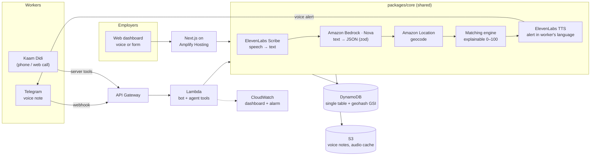

<div align="center">

# KaamSetu · काम सेतु

### Kaam milega. *Paas mein.*
**Work, found by voice, within walking distance.**

A voice-first, multilingual, hyper-local job network for India's informal workers.<br/>
Workers join with a **Telegram voice note** or a **phone call**. Employers **speak** a job. Matches are **ranked, explained, and announced out loud** in the worker's own language.

Devnovate Ideathon 2026 · Track 4 (Mystery Track "UnlockED") · Problem 3 · **Team Meteora**

### 🔗 Live: [main.d1ro3ffmsok6d8.amplifyapp.com](https://main.d1ro3ffmsok6d8.amplifyapp.com)
[Post a job](https://main.d1ro3ffmsok6d8.amplifyapp.com/hire) · [Worker ID card](https://main.d1ro3ffmsok6d8.amplifyapp.com/w/w_ramesh) · [Live ops](https://main.d1ro3ffmsok6d8.amplifyapp.com/live) · [Architecture](https://main.d1ro3ffmsok6d8.amplifyapp.com/about)



</div>

---

## The problem

India has **~450 million informal workers**: plumbers, electricians, masons, painters, drivers, cooks, helpers, domestic workers. Job platforms are built for English-literate, white-collar, desktop users. A mason in Pune who speaks Marathi and owns a ₹7,000 Android phone finds work through a *thekedar* (contractor) who takes a **10–30% cut**, or by standing at a labour *naka* at **7 AM** hoping to be picked.
Small employers (a shop owner needing a helper for 3 days, a family needing a plumber *today*) have no reliable way to find verified workers nearby, fast.

## The solution

| | |
|---|---|
| 🎙️ **Join by voice** | A worker sends a voice note in Hindi, Marathi or English: *"Mera naam Ramesh hai, main plumber hoon, Kothrud mein rehta hoon, 800 rupaye roz chahiye."* KaamSetu transcribes it (**ElevenLabs Scribe**), extracts a profile (**Amazon Bedrock · Nova**), maps the area (**Amazon Location**) and **replies with a spoken confirmation in the worker's language**. |
| 🗣️ **Hire by voice** | An employer says *"Need 2 painters near Baner for 3 days, ₹900 a day, start tomorrow."* The fields fill themselves in and ranked matches appear on a live map. |
| 🧭 **Explainable matching** | Every match carries a score (0–100) and a one-line reason: *"Plumber · 1.3 km away · asks ₹800 (you offer ₹850) · 4.8★ from 12 jobs"*. |
| 🔔 **Voice job alerts** | Top matches get a Telegram **voice alert** in their language with **Accept / Not interested / Call**. Contacts unlock only after a mutual accept. |
| ☎️ **Kaam Didi** | An **ElevenLabs Conversational AI** agent: workers who can't read or type can register, hear nearby jobs and accept one, entirely by voice. |
| 🪪 **KaamScore** | Ratings build a portable trust score and verified skill badges on a shareable **digital ID card** (`/w/[id]`). |

<table>
<tr>
<td width="62%"></td>
<td></td>
</tr>
<tr>
<td></td>
<td></td>
</tr>
</table>

## Architecture



One **core package** powers the website, the Telegram Lambda and the voice-agent tools, so behaviour is identical everywhere. **Every external call is behind an adapter with a realistic mock**, and `DEMO_MODE=true` runs the full product with zero external dependencies.

### AWS services

| Service | Role in KaamSetu |
|---|---|
| **Amazon Bedrock** (Converse API, **Amazon Nova Pro**) | Turns messy Hindi/Marathi/English transcripts into strict JSON profiles and jobs (zod-validated, one corrective retry, rule-based fallback). Model-agnostic: switching to Claude is a `BEDROCK_MODEL_ID` change. |
| **AWS Lambda** | Telegram webhook and the ElevenLabs agent server tools (Node 22, ARM64, X-Ray). |
| **Amazon API Gateway** (HTTP API) | `POST /telegram`, `POST /agent/{tool}` |
| **Amazon DynamoDB** | Single-table design: workers, jobs, matches, ratings, sessions and the live feed. GSI1 = geohash-4 cell (nearby search over 9 cells), GSI2 = chat/worker lookups, GSI3 = type/time listings, TTL on feed events. |
| **Amazon S3** | Worker voice notes (private), cached TTS audio and demo clips (public read). |
| **Amazon Location Service** | Places v2 geocoding with an India filter and Pune bias; map tiles for the dashboard. |
| **AWS Amplify Hosting** | Next.js 15 SSR web app (monorepo), with an SSR compute role for DynamoDB/Bedrock. |
| **Amazon CloudWatch** | Dashboard (invocations, errors, p90 latency, DynamoDB capacity) + an error alarm on the webhook. |

All of it is defined in one **AWS CDK** stack: [`infra/lib/kaamsetu-stack.ts`](infra/lib/kaamsetu-stack.ts).

### ElevenLabs usage

| Feature | Where |
|---|---|
| **Speech-to-Text (Scribe)** | Worker voice notes on Telegram; the employer's mic on `/hire`. Auto language detection, with the chosen language passed as a hint. |
| **Text-to-Speech, Multilingual v2** | Spoken onboarding: welcome, consent, profile read-back, confirmations (voice note + caption, so low-literacy users can follow along). |
| **Text-to-Speech, Flash v2.5** | Low-latency **job alerts** in Hindi / Marathi / English. Cached by text hash. |
| **Conversational AI agent "Kaam Didi"** | Voice-only registration, job search and acceptance through three **server tools** (`register_worker`, `find_jobs_near_me`, `accept_job`). Provisioned by [`scripts/create-elevenlabs-agent.ts`](scripts/create-elevenlabs-agent.ts) and tested end to end by [`scripts/test-agent.ts`](scripts/test-agent.ts) (ElevenLabs agent simulation against the live webhooks). |
| **Pre-generated demo audio** | The landing page's phone demo and language showcase, so the pitch never depends on the network. |

## Matching algorithm

```
score = 100 × ( 0.35·skill + 0.25·proximity + 0.15·wageFit + 0.15·trust + 0.10·availability )
```

| Component | How it's computed |
|---|---|
| **skill** | 1 for an exact trade; partial credit via a **skill graph** (e.g. painter ← mason 0.6, electrician ← AC technician 0.6); 0 means excluded |
| **proximity** | 1 at 0 km, linear decay to 0 at the job's radius (default 8 km) |
| **wageFit** | 1 if the worker asks ≤ the offer; decays linearly to 0 at 40% above it |
| **trust (KaamScore)** | Bayesian-smoothed rating (prior 3.5★ × 3) + completion rate + volume + verified bonus |
| **availability** | 1 if free on the start date, 0.4 if free within 2 days, 0 if busy |

The **why** line is generated deterministically from these numbers. Code: [`packages/core/src/matching.ts`](packages/core/src/matching.ts), tested in [`matching.test.ts`](packages/core/src/matching.test.ts).

## Privacy and safety
- **Consent first:** the bot explains what it stores, out loud, before saving anything.
- **Phone numbers are never public**, revealed only after a mutual accept.
- **Locality, not location:** public views show a neighbourhood; exact coordinates stay private and map pins are jittered by about 300 m.
- **"Delete my data"** by voice or `/delete` removes the profile, ratings and match history.
- **Fair-wage nudge:** offers below the local minimum wage are flagged; job posts are rate-limited.

## Run it locally (5 commands)

```bash
git clone https://github.com/Krishna-cpp/kaamsetu && cd kaamsetu
npm install
cp .env.example .env        # everything is optional: with no keys the app runs on realistic mocks
npm run seed                # 60 workers and 20 jobs across Pune
npm run dev                 # http://localhost:3000
```

Optional:
```bash
npm run bot                 # Telegram bot (long-polling; needs TELEGRAM_BOT_TOKEN)
npm run pregen:audio        # regenerate demo audio (needs ELEVENLABS_API_KEY)
npm run agent:create        # create/update the Kaam Didi agent + tools
npm run agent:test          # end-to-end agent simulation against the live tools
npm test                    # Vitest: matching engine + Hindi/Marathi/English parser
```

Deploy to AWS: see [`infra/bin/app.ts`](infra/bin/app.ts) (`npx cdk deploy --profile <profile>`).

## Repository layout

```
apps/web/          Next.js 15: landing, /hire, /w/[id], /live, /about, API routes
services/bot/      Telegram long-polling runner + AWS Lambda handlers (Telegram webhook, agent tools)
packages/core/     Schemas (zod), matching engine, i18n, skill graph, Pune localities,
                   adapters (LLM, STT, TTS, geo, channel, storage) with mocks, DynamoDB + file repos, bot logic
infra/             AWS CDK stack
scripts/           seed, pregen-audio, create/test ElevenLabs agent, screenshots, Lighthouse
docs/              demo-script.md, pitch-notes.md, screenshots
```

## Roadmap
- **WhatsApp Cloud API** channel (same interface as Telegram) and a **missed-call → callback** number.
- Tamil, Telugu, Kannada, Bengali (a config change in `languages.ts` plus strings).
- **UPI wage escrow**, **ONDC / e-Shram** integration, skill-verification videos.

## Team Meteora
| | |
|---|---|
| **Krishna Kumar** | Team lead · Full-stack |
| **Mithun G** | Voice AI |
| **Samvrith Singh V** | Cloud & data |
| **Sreesanth Narayanan** | Product & design |

MIT License
